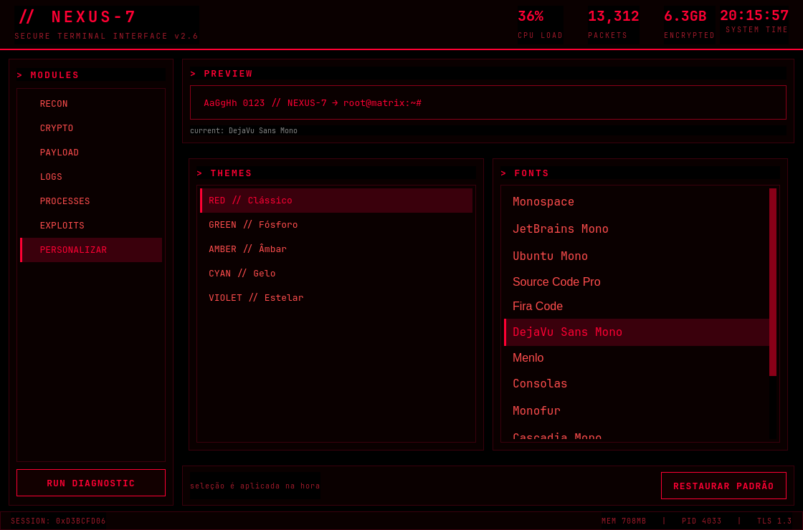

# NEXUS-7 · Painel de Controle Central 🖥️

```
  ███╗   ██╗███████╗██╗  ██╗██╗   ██╗███████╗   ███████╗
  ████╗  ██║██╔════╝╚██╗██╔╝██║   ██║██╔════╝   ╚══███╔╝
  ██╔██╗ ██║█████╗   ╚███╔╝ ██║   ██║███████╗     ███╔╝
  ██║╚██╗██║██╔══╝   ██╔██╗ ██║   ██║╚════██║    ███╔╝
  ██║ ╚████║███████╗██╔╝ ██╗╚██████╔╝███████║   ███████╗
  ╚═╝  ╚═══╝╚══════╝╚═╝  ╚═╝ ╚═════╝ ╚══════╝   ╚══════╝
        S E C U R E   T E R M I N A L   I N T E R F A C E
```

Chega de viver em **5 terminais abertos** tentando lembrar em qual deles rodou o
scan, qual tem o log subindo, qual tá congelado. O NEXUS-7 junta **tudo num lugar
só**: um painel preto/vermelho estilo hacker, com cantos retos, sem frescura.

---

## 🤷 Por que usar?

O modo "normal" de trampar com terminal é uma bagunça:

- 1 janela pro scan
- 1 janela pros logs
- 1 janela pra ver processo
- 1 janela só pra procurar aquele comando que você esqueceu a flag

O NEXUS-7 é o **cockpit**: toda ação cai no mesmo stream de saída, os módulos
ficam na barra lateral e você dispara tudo por um campo de comando só. Zero
context-switching.

> Não é "mais um terminal". É o centro de comando. 🕹️

---

## 📸 Preview



---

## ✨ O que tem por dentro

| Área | Função |
|------|--------|
| **Módulos** | Sidebar de acesso rápido: recon, crypto, payload, logs, processos, exploits |
| **PERSONALIZAR** | 5 temas (vermelho, verde fósforo, âmbar, ciano, violeta) + 12 fontes monoespaçadas, aplicados na hora |
| **Output Stream** | Console único, com timestamp em tudo |
| **Command Input** | Um campo pra comandos internos **e** shell de verdade |
| **Telemetria** | CPU, pacotes, dados cifrados e relógio atualizando sozinhos |
| **Status bar** | Sessão, memória, PID e TLS |
| **Boot animado** | Sequência de "inicialização" toda dramática ao abrir 👾 |

Estética: **preto + vermelho**, tudo em **cantos retos**, bordas finas de 1px,
fonte monoespaçada. Sem circo, sem blob, sem gradiente. Puro terminal.

---

## 🛠️ Instalação

Precisa de Python 3.10+ e PySide6:

```bash
pip install PySide6
```

## ▶️ Rodar

```bash
cd hack_painel
python3 hacker_gui.py
```

Digita no campo de comando e manda **ENTER**.

---

## ⌨️ Comandos internos

| Comando | O que faz |
|---------|-----------|
| `help` / `?` | Mostra os comandos |
| `clear` | Limpa a tela |
| `scan` | Faz uma varredura de rede fake (`10.0.0.0/24`) |
| `crypto <texto>` | Cifra o texto que você passar |
| `custom` | Abre a página de personalização |
| `sysinfo` | Info (fictícia) do sistema |
| `run <comando>` | **Roda comando REAL no shell** e joga o resultado aqui |
| `exit` / `quit` | Fecha o painel |

### ⚡ O pulo do gato: `run`

`run` é o elo entre o painel e a máquina de verdade. Sem trocar de janela:

```
root@matrix:~# run nmap -sV 10.0.0.1
root@matrix:~# run tail -n 50 /var/log/syslog
root@matrix:~# run df -h
```

Tudo cai no mesmo stream com timestamp. Centralização pura.

---

## 🚨 Segurança (não pule isso)

O `run` executa **shell de verdade** (`bash -c`). Então:

- não rode como `root` o tempo todo à toa;
- o processo herda o ambiente do painel;
- telemetria e scans são simulados — o painel não "hackea" nada sozinho;
- feche com `exit` ou `quit` quando terminar.

---

## 📁 Estrutura

```
hack_painel/
├── hacker_gui.py     # o painel todo
├── screenshot.png    # preview
└── README.md         # este arquivo
```

Dentro do código:

```
HackerGUI
├── _header           # brand + telemetria + relógio
├── _sidebar          # módulos
├── _console_panel    # stream de saída
├── _command_panel    # campo de comando
└── _statusbar        # sessão / memória / TLS
_execute()            # roteador de comandos
_spawn_shell()        # shell real via QProcess
_tick()               # telemetria a cada 1s
```

---

## 🚀 Ideias (roadmap)

- Abas de saída (um stream por módulo)
- Histórico de comandos com seta ↑ ↓
- Temas alternativos (âmbar, verde-fósforo)
- Exportar o log da sessão
- Gráficos pra telemetria

---

## 📜 Licença

Livre. Use, quebre, modifique, estrague, conserte. Feito pra centralizar e aprender.